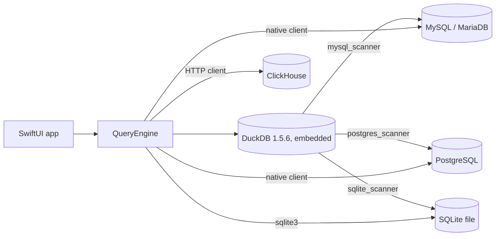
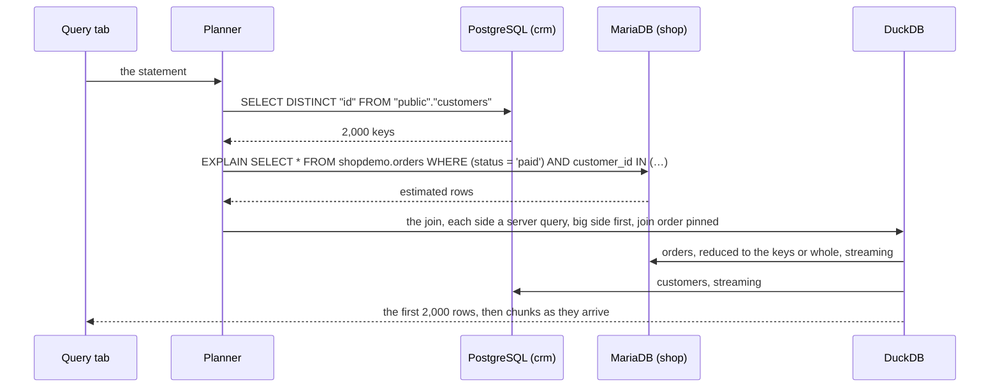

# Architecture

How one statement reaches four kinds of database and comes back as one streaming
result, and why the app is built the way it is. The rules a query follows are in
[QUERYING.md](QUERYING.md); what each part of the app does is in
[FEATURES.md](FEATURES.md). Every name below is a type or a file in the repository, so
you can read along.

## The shape of it



One in-memory DuckDB lives inside the app. Every MySQL, PostgreSQL or SQLite
connection is attached to it as a catalog named after the connection's alias, through
DuckDB's scanner extensions, so `shop.orders` and `crm.customers` are two tables of one
engine that can join them.

ClickHouse is the one engine that is not attached, which is why it hangs off
`QueryEngine` in the diagram rather than off DuckDB. When this was built, DuckDB's only
ClickHouse extension was a community build a few weeks old, so the app talks to
ClickHouse over its HTTP interface with a small client of its own instead. That single
difference explains every ClickHouse rule in this guide:

| | MySQL / MariaDB, PostgreSQL, SQLite | ClickHouse |
|---|---|---|
| How the app reaches it | attached to DuckDB through a scanner extension | its HTTP interface, through the app's own client |
| A statement that names only it | runs on that server; a SQLite file's runs in SQLite itself (a read through DuckDB's `sqlite_query`, the rest in macOS's `sqlite3`) | runs on ClickHouse, never touching DuckDB |
| A join with one other server | both sides stream through DuckDB, the bigger side reduced to the smaller side's keys | its side is copied into a DuckDB temp table first, then joined the same way |
| Joins it can take part in | any shape DuckDB runs, three tables or more included | two tables, one of them ClickHouse |
| Column types in a join | DuckDB's own mapping in the scanner | integers, floats, booleans, dates and timestamps typed; the rest as text |

That is the whole trick. Everything below is about making it fast and honest: fast,
because a naive join would drag whole tables across the network; honest, because the
app tells you exactly what it sent to each server.

## A map of the code

| Layer | Files | What they do |
|---|---|---|
| App state | `Models/WorkspaceSession.swift`, `QueryTab.swift`, `Utilities/AppSettings.swift` | The open connections, query tabs, the console log and history, saved queries, which panel is active. Settings live in UserDefaults: theme, editor font size, tab width, auto-complete, Content's rows per page. |
| Connections | `Engine/ConnectionManager.swift`, `Utilities/ConnectionStore.swift`, `Keychain.swift`, `Engine/SSHTunnel.swift`, `Utilities/SupportDirectory.swift` | The saved list (`connections.json`), passwords (Keychain items per connection id under the service "SequelBridge"), connect and disconnect, SSH port forwards, where the app's files live. |
| Engine | `Engine/QueryEngine.swift` and its `+Postgres`, `+SQLite`, `+ClickHouse` extensions | One DuckDB, four connections to it, attach and detach, streaming results, the planner's entry points, per-engine metadata. |
| Planner | `Engine/SQLBuilder.swift` (+ `SQLBuilder+Postgres.swift`), `Engine/SQLPushdown.swift` | Statement classification (`isReadOnly`, `isRowReturning`, `referencesAlias`, `detectCrossJoin`, `detectSemiJoin`), the rewrites (`crossJoinRewrite`, `planFallback`), per-dialect quoting and DDL, and which WHERE conditions each server can be trusted with. |
| Routing | `Models/QueryRoute.swift`, `SQLScript.swift`, `QueryEffects.swift` | Which path a Query-tab statement takes (below); a script split into statements, a `DELIMITER` line, a `BEGIN … END` body and a `$$` quote kept whole; which statements run as typed, on a native client or on one connection; what a run changes in the left panel (`USE`, DDL). |
| Native clients | `Engine/ClickHouseClient.swift`, `Engine/MySQLClient.swift`, `Engine/MySQLDirectConnection.swift`, `Engine/PostgresClient.swift`, `Engine/WireLink.swift`, `Engine/SQLiteTool.swift` | ClickHouse over HTTP; minimal MySQL and PostgreSQL wire-protocol clients for what the passthrough can't run or nest (`EXPLAIN`, `SHOW`, MySQL's `HELP`, `CHECK TABLE` and `CALL`, PostgreSQL's writes and reads outside `public`, a script on one connection), over one shared byte stream that can switch to TLS part-way; macOS's `sqlite3` for a SQLite file's statements. |
| Results | `Models/QueryResult.swift`, `CellTable.swift`, `StreamBatcher.swift`, `RunClock.swift`, `ChartData.swift`, `Engine/ResultExporter.swift` | The result's columnar storage, when streamed chunks reach the screen, one clock per run, chart series, CSV/JSON/Markdown/SQL export. |
| Views | `Views/Home/*`, `Views/Workspace/*`, `Views/Settings/*`, `Views/Connection/*` | Home and the connection form; the workspace: toolbar tabs (`WorkspaceView`), sidebar, the Query tab (`QueryPanelView`, which carries out each statement's route), editor, results grid and chart, and one file per panel; Settings; the SSH login dialog. |
| Stores | `Utilities/HistoryStore.swift`, `SavedQueryStore.swift`, `CSVParser.swift`, `ConsoleExporter.swift` | Statement history (`history.jsonl`, append-only, compacted at 1,000 entries), saved queries (`saved_queries.json`), an RFC 4180 CSV reader, the console's `.sql` export. |
| Scripts | `scripts/` | `fetch-duckdb.sh` (DuckDB with its scanners built in, as static libraries), `build-duckdb.sh` and `package-duckdb.sh` (that package, built from source), `run-all-tests.sh` (containers, fixtures, the whole matrix), `seed-demo.sh` and `capture-screenshots.sh` (the demo data and the guide's images), `check-docs.sh`, `acknowledgements.py` (the licenses Help → Acknowledgements shows), `build-release.sh` (the notarized DMG, `appcast.xml` and the Homebrew cask), `build-appstore.sh` and `appstore-screenshots.sh` (the App Store package and screenshots), `test-appstore-build.sh` and `check-appstore-sandbox.sh` (the App Store build checked, and run in its sandbox), `project-version.sh` (the one version every target carries). |
| Vendored DuckDB | `vendor/DuckDB/` | The Swift wrapper with three local patches, and the recipe that builds DuckDB with its scanners (`recipe/`); the libraries themselves are fetched, not committed. |
| Updates | `Utilities/AppUpdater.swift`, `vendor/Sparkle/` | Sparkle 2.10, vendored: the daily check for a new version (asked first), **SequelBridge → Check for Updates…** and Settings → Updates; the feed is `appcast.xml` on the latest GitHub release. The DMG build only: the App Store updates its own. |
| The App Store build | `Utilities/Distribution.swift`, `Grants.swift`, `Paths.swift`, `SandboxCheck.swift`, `sb-askpass` | Which build this is and what it offers, what the user granted the sandbox (security-scoped bookmarks), `~` as the user's home, the sandbox self-check; the askpass helper both builds ship. See [Two builds](#two-builds). |

## A connection's life

1. On Home you tick connections and press Connect. `ConnectionManager.connect` first
   detaches any alias still attached from an earlier workspace, then resolves each
   password: a fixture's inline password if the app was launched on one, else the
   Keychain item for that connection id, else an empty string for a SQLite file.
2. `QueryEngine.attach` does the engine-specific work:
   - **MySQL / MariaDB, PostgreSQL.** The scanner extension is built into the app and
     loaded when DuckDB starts (`ensureExtensionLoaded` checks, and `LOAD`s it if it
     isn't). A DSN is built for TCP/IP, a local
     socket, or SSH. A MySQL socket is the DSN's `socket=` file; a PostgreSQL socket
     becomes libpq's `host=<directory> port=<n>`, taken from the directory or from the
     `.s.PGSQL.<n>` file the user gave. For SSH, `startTunnel` opens an `SSHTunnel`
     (below) first and the DSN points at its local port. Then
     `ATTACH '<dsn>' AS "alias" (TYPE mysql)` or `(TYPE postgres)`. The DSN's database is
     remembered, because the passthrough needs one, and so is the endpoint the built-in
     MySQL and PostgreSQL clients use: the tunnel's local port or the socket.
   - **SQLite.** `ATTACH '<path>' AS "alias" (TYPE sqlite)`.
   - **ClickHouse.** A `ClickHouseClient` with host, port, user, password and TLS, tried
     with `SELECT 1`; through SSH, it talks to the tunnel's local port. Nothing is
     attached to DuckDB, and a socket is refused with a message, since the HTTP
     interface has none.

   **The tunnel.** `SSHTunnel` runs `/usr/bin/ssh -N -L <local>:<host>:<port>` with
   the key set on the connection only (`IdentitiesOnly`), or with none set, ssh's usual
   keys and ssh-agent. What ssh asks while it logs in (a password, a key's passphrase, a
   one-time code, whether to trust a server it hasn't met) reaches the app through
   `SSH_ASKPASS` (`SSHAskpass`), and `SSHLoginPrompt` shows it. Servers' keys are checked
   against `~/.ssh/known_hosts` as in Terminal (`StrictHostKeyChecking=ask`); a changed
   one stops the login, `SSHHostKeyChange` reads ssh's warning, and once the user has
   confirmed the new key, `SSHTunnel.forget` removes the old one (`ssh-keygen -R`). With
   nothing to answer (the tests), ssh runs in `BatchMode` and trusts a new server once
   (`accept-new`). `ssh-rsa` is appended to the accepted host-key and signature types: OpenSSH 8.8 and later switched it off,
   which locked out servers running OpenSSH 7.1 and older ("no matching host key type
   found. Their offer: ssh-rsa"). Appended, it is used only when the server offers
   nothing newer. A tunnel ends when its connection is closed, and every tunnel ends
   when the app quits: a child process outlives its parent on macOS, so `ssh` would
   otherwise keep the session open in the background.
3. Picking a database on MySQL attaches the connection again with that database as the
   DSN default (`ConnectionManager.switchDatabase`), through the SSH tunnel already
   running, so ssh doesn't log in again. `mysql_query` runs on the connection's default
   database, so this is what makes an unqualified table name in your statement resolve
   on the server. On PostgreSQL the picker lists the database's schemas, and picking one
   leaves the attachment as it is: a read in `public` goes through `postgres_query`, and
   one in another schema to the native client with that schema first on its
   `search_path`, or, inside a transaction begun in the Query tab, through
   `postgres_query` with the schema first on the transaction's `search_path`.
4. Disconnecting detaches the catalog, drops the connection's metadata cache, and stops
   its tunnel.

A read-only connection is remembered by the engine at attach time; every write path
checks it (`ensureWritable`) before anything reaches a server. Below that, DuckDB
attaches it `READ_ONLY` (DuckDB refuses a write to it, `mysql_execute` included, and
the scanners' transactions are read-only on the server), the native MySQL and
PostgreSQL sessions are read-only, and ClickHouse gets `readonly=2`, unless the account
is read-only on the server already.

## How a statement is dispatched

`QueryRoute.plan` (`Models/QueryRoute.swift`) decides where a statement runs, and
`QueryPanelView.runTypedQuery` carries it out. `SQLScript` first splits the editor's text
into statements; a `DELIMITER` line, a `BEGIN … END` body and a `$$` quote keep their
semicolons. A script whose statements share what each sets (a variable, a temporary
table, a transaction: `QueryEffects.needsOneSession`) runs whole on one connection of the
server's native client, or in one run of `sqlite3` (`QueryRoute.sessionScript`).
Otherwise each statement runs in turn, and the first that fails stops the run. For each:

1. `USE db` on MySQL, or `SET search_path TO x` on PostgreSQL, is the same switch as
   picking that database or schema in the left panel.
2. If it writes (`SQLBuilder.isReadOnly` says no) and the server it runs on (the one it
   names, else the one picked in the left panel) is read-only, it is refused with that
   connection's name; a writable connection open beside it is unaffected. MySQL's
   `LOCK TABLES` and `SET autocommit`, a `CALL` inside a `BEGIN` typed in the Query tab,
   and on PostgreSQL a `SET` or `RESET` inside one other than `SET LOCAL`, are refused
   too, saying why.
3. A typed `EXPLAIN …` that names one MySQL or PostgreSQL server takes the Explain
   button's path: the server's own plan, on that server's native client, since the
   scanner can run it on neither.
4. Otherwise the servers it names are counted (`referencesAlias` per alias) and the
   statement goes down one of these paths. Every path keeps a plain form of the
   statement as its backstop, so a plan that cannot proceed falls back rather than
   failing.

| The statement | Path | What the servers see |
|---|---|---|
| a read on one MySQL server's attached database, or on one PostgreSQL server in `public` | passthrough | the statement, as written, inside `mysql_query('alias', '…')` or `postgres_query(…)`; the server executes it, DuckDB streams the result. A read the passthrough refuses (two columns of one name; on MySQL a date with a zero month or day) runs again on the native client |
| `SHOW`; on MySQL `HELP`, `CHECK`, `CHECKSUM`, `CALL` and MariaDB's `BEGIN NOT ATOMIC`; on PostgreSQL a read in another schema, a write, `COPY`; a lone `SET` | native | the statement as written, on the server's native client, in the database (PostgreSQL: schema, first on the `search_path`) picked; the whole result comes back |
| any other MySQL statement that returns no rows | as typed | `CALL mysql_execute('alias', '…')` in a DuckDB transaction of its own, then `SELECT ROW_COUNT()` |
| a statement for one MySQL or PostgreSQL server inside a `BEGIN` typed in the Query tab | that transaction | DuckDB's: a read through the passthrough in any schema, any other MySQL statement and a PostgreSQL write or `SET LOCAL` through `mysql_execute` or `postgres_execute`; on PostgreSQL the schema picked goes first on the transaction's `search_path` (`transactionSearchPath`). `SHOW` and `EXPLAIN` still run on the native client, outside it |
| `BEGIN`, `COMMIT`, `ROLLBACK`, and anything else on one server | DuckDB | DuckDB's catalog, after `USE "alias"."database"` |
| names one ClickHouse server | native | the statement on ClickHouse over HTTP, with `alias.table` turned into `database.table` |
| names only a SQLite file | SQLite | a read through DuckDB's `sqlite_query`, run again in macOS's `sqlite3` (`SQLiteTool`) when the scanner's older SQLite can't; anything else in `sqlite3`; inside a `BEGIN` typed in the Query tab, DuckDB's catalog, in that transaction |
| `… WHERE x IN (SELECT … FROM other.table)` across two servers | semi-join | the subquery on its server first, its values inlined (up to 10,000), then the outer statement on its own server |
| two tables on one key, inner join, in `JOIN … ON` or comma form | streaming cross-server join | the steps traced below |
| the same with one ClickHouse side | ClickHouse bridge | the ClickHouse side copied first, then the steps below |
| anything else across servers | fallback | each remote table bound, then copied, then DuckDB runs the statement |

## One query, traced

The Console tab shows every statement the app sends. Here is the two-table join from
the guide, run against the demo servers, with what went where.

```sql
SELECT o.id, o.placed_at, o.status, c.full_name, c.email
FROM shop.orders o JOIN crm.customers c ON o.customer_id = c.id
WHERE o.status = 'paid'
ORDER BY o.placed_at DESC
```



| Step | Statement the app sent | Where | Result |
|---|---|---|---|
| 1 | `SELECT DISTINCT "id" FROM "public"."customers"` | PostgreSQL | 2,000 keys in 0.014 s |
| 2 | `EXPLAIN SELECT * FROM shopdemo.orders WHERE (status = 'paid') AND customer_id IN ('1', '2', …)` | MariaDB | the server's own row estimate |
| 3 | the join, with each side a server query inside one DuckDB statement | both, streaming | 2,506 rows in 0.324 s |

Step 1 picks the *probe* side: the table the servers estimate to be smaller
(customers, 2,000 rows, against orders, 5,000) gives up its distinct join keys, with
its own WHERE conditions applied on its server first. Step 2 asks the other server how
much of its table those keys would select. Below 40 % of the table, the orders query is
sent with `customer_id IN (…)` so only matching rows cross the wire; at 40 % or more, or
with more than 10,000 keys, the whole side comes instead, because a table scan on the
server beats pulling most of a table through an index. Step 3 runs both server queries
as streaming subqueries of one DuckDB statement and joins the rows as they arrive.
Nothing is written to a temp table; the first rows reach the grid while the bigger side
is still coming in.

The three-engine query on the README takes a different path, because it joins four
tables:

| Step | Statement | Why |
|---|---|---|
| 1 | `SELECT * FROM "public"."customers" LIMIT 0`, and the same for `orders` and `order_items` | bind the statement against the real column shapes before fetching anything, so a misspelled column fails in milliseconds |
| 2 | `SELECT * FROM "public"."customers"`, `SELECT * FROM shopdemo.orders`, `SELECT * FROM shopdemo.order_items`, each with the WHERE conditions the server can be trusted with | copy each remote table into a DuckDB temp table through its server's own query path |
| 3 | the statement itself on DuckDB, reading the temps and the SQLite file in place | 200 rows in 0.029 s |
| 4 | `DROP TABLE IF EXISTS "__sb_mat_0"` … | clean up |

That path is correct for any SQL DuckDB understands, and it is the fallback for every
plan that cannot proceed. Its cost is the copy, which is why the guide says to keep
cross-server statements to two tables on one key when the tables are large.

## The cross-server join in detail

**Recognizing one** (`SQLBuilder.detectCrossJoin`). Two base tables from two different
connections, an inner join on one key: `FROM a.t1 x JOIN b.t2 y ON x.k = y.k`, or the
comma form `FROM a.t1 x, b.t2 y WHERE x.k = y.k AND …` where the key equality is a
top-level `AND` conjunct of the WHERE. Outer joins, three tables, a key equality under
an `OR` or inside parentheses: not this path.

**Choosing sides** (`crossJoinBigSide`). The *big* side is the one that streams through
the join from its server; the *probe* side gives up its keys. A side without a server
query path (a SQLite file) is always the probe. Between two servers, the larger row
estimate is big; an unknown estimate counts as the largest; a tie makes the first
table the probe. Estimates come from the servers' own catalogs: the row count MySQL
keeps for the table (`SHOW TABLE STATUS`), `reltuples` in PostgreSQL with a fallback
to the statistics collector's live count for a table never analyzed.

**Reducing the big side** (`QueryEngine.keyReductionPlan`). The probe's distinct keys
are fetched through its server with its pushed WHERE. More than 10,000 keys cannot be
inlined, so the whole side comes. Otherwise the big side's server is asked, with
`EXPLAIN`, how many rows the statement with the `IN` list would touch; at 40 % of the
table or more the whole side comes. The threshold is measured, not guessed: on a real
server a key list covering 2.6 million of 2.6 million rows took 300 seconds to return
through the index, against 30 seconds for a plain whole-table fetch. No estimate means
reduce.

**Rewriting the statement** (`crossJoinRewrite`). Only the `FROM … JOIN … ON` clause
changes: each side becomes a parenthesized server query, `(SELECT … FROM
mysql_query('shop', '…'))`, the big side listed first, with a `SELECT *` spelled out
per side so the output columns keep your order. The aliases, the WHERE and the rest of
the statement still resolve as you wrote them.

**Pinning the join order.** DuckDB cannot see how big a server query's result is; it
estimates every table function at one row and, between equal estimates, builds its
hash table on the narrower side. On real data that put a 4.7-million-row side on the
build side, and the first row could not appear until all of it had arrived. The join
statement therefore runs after `SET disabled_optimizers =
'join_order,build_side_probe_side'` on its connection: DuckDB probes with the big side
and builds its hash table on the probe side, the big side flows through, and rows
appear within seconds. The connection resets the setting right before its next
statement, not when the stream opens, because any statement on a connection closes
its live stream.

## What the servers are trusted with

Predicate pushdown (`SQLPushdown.swift`) gives each table the WHERE conditions it can
answer on its server: its own, plus any carried to it across the join key (`x.k = y.k`
and `x.k = 'A'` imply `y.k = 'A'`). The principle that keeps results identical: DuckDB
still evaluates your whole WHERE on the rows that come back, so a pushed condition
only has to admit every row DuckDB would keep. It may be a superset filter, never a
stricter one. That rules the shapes:

| Column kind | Pushed | Kept for DuckDB, and why |
|---|---|---|
| strings | `=`, `IN`, `LIKE`, `IS [NOT] NULL` | `<>`, `<`, `>`, `NOT IN`, `NOT LIKE`, `BETWEEN`: under a case-insensitive server collation they would drop rows DuckDB keeps |
| numbers, dates, timestamps | every comparison, `BETWEEN`, `IN`, `NOT`, with a literal of the same kind (dates only as ISO text) | other literal shapes |
| ClickHouse `Enum8` / `Enum16` | `=`, `IN`, `IS [NOT] NULL` | `LIKE` |
| any | | functions, arithmetic, subqueries, a branch of an `OR`, a bare column that two tables share, a string literal with a backslash |

A pushed condition is written in the server's dialect (backticks or double quotes) and
runs there with an index if the server has one; what is not pushed still applies, in
DuckDB, on the rows that arrive.

## The other paths

**Passthrough.** A read naming one MySQL server's attached database, or PostgreSQL's
`public` schema (any schema inside a transaction begun in the Query tab), is sent as
`SELECT * FROM mysql_query('alias', '<your statement>')` (or `postgres_query`, with its
`--` comments turned into `/* */` so the brackets around it hold). The server executes
it as written; DuckDB only streams the result. This is why a single-server read is
server-native SQL, LIMIT and all, with no scanner in the way. A statement that returns
no rows goes as typed: on MySQL through `mysql_execute`, then `ROW_COUNT()`; on
PostgreSQL on the native client, or through `postgres_execute` inside a transaction
begun in the Query tab.

**Semi-join** (`detectSemiJoin`). `WHERE x IN (SELECT … FROM other.table)` across two
servers runs the subquery on its server first, inlines its values with `inValueList`
(up to 10,000 non-null values), and pushes the outer statement to its own server. Too
many values, or a subquery that turns out correlated, and the statement falls back.

**Fallback** (`planFallback`). Every `alias.table` reference to a MySQL or PostgreSQL
table is collected once per table and replaced by a temp identifier (`__sb_mat_N`).
Each table is first bound with `LIMIT 0` so a wrong column fails before any row moves,
then copied with `CREATE TEMP TABLE … AS SELECT * FROM mysql_query(…)` carrying its
pushed WHERE, through the same extension and type mapping the scanner uses, so the
rows are identical. The rewritten statement runs on the temps, with a SQLite file read
in place, and the temps are dropped afterwards.

**ClickHouse bridge** (`clickHouseJoinPlan`, `materializeClickHouse`). The ClickHouse
side is fetched over HTTP into a DuckDB temp table whose columns are typed through
`clickhouseToDuckType` so the join keys line up. When ClickHouse holds the bigger
table, the fetch is reduced to the other side's keys with `toString(key) IN (…)`; its
pushed WHERE runs in ClickHouse either way. The join then proceeds as a cross-server
join with the temp on one side.

## Results stream

A result is never materialized twice. Inside the engine, four DuckDB connections each
live in a `SerialConnection` actor: one for the Query tab, one for the Content browser,
one for fast schema metadata and one for slow statistics, so a long query never blocks
browsing a table and the sidebar never blocks a query. Every statement runs as a DuckDB
streaming result and chunks are pulled on the actor, off the main thread.

The metadata connection is shared by the Structure, Relations and Triggers tabs, so one
slow lookup there stalls all three. Each lookup reads one table: `SHOW FULL COLUMNS`,
`SHOW INDEX`, `SHOW TRIGGERS`, or an information_schema query that filters every
information_schema table it reads by schema and table name, with literals. MariaDB, and
MySQL before 8, answer anything else by opening every table on the server.

DuckDB allows one live streaming result per connection; running anything else on it
closes the stream. So each open stream has its own cursor, and before another
statement starts on that connection the actor fetches every open stream's remaining
chunks into its cursor's buffer: an earlier query in another tab still completes with
its full result. A statement DuckDB cannot prepare (several statements in one string)
falls back to a materialized result read by row ranges.

`openStreamingQuery` returns the first 2,000 rows immediately for the first paint and a
handle for the rest. Each pulled chunk is converted in one pass into a `CellTable`
chunk: per column, one UTF-8 buffer with every value back to back, one end offset per
row, and a null flag per row only where the column has NULLs. That is the text itself
plus about four bytes a cell, where the `[[String]]` it replaced cost about 120 bytes a
cell and put a 4.7-million-row result at 6 GB. Chunks are immutable and appended as
the stream arrives, so growing a result never copies what is already there; a cell is
found by a binary search over the chunk starts, and values are decoded to `String`
only for the cells on screen.

`StreamBatcher` decides when chunks reach SwiftUI: the stream pulls 20,000-row chunks,
and publishing each one would re-render the workspace and copy the tab's growing
result (the tab is a value in a published array), which made a million rows cost fifty
full copies. Chunks are buffered and flushed when enough rows have accumulated or
enough time has passed, so the row counter keeps moving while publishes stay bounded
to a handful per million rows. The table view draws frame-based cells, so growth is an
append rather than a reload. One `RunClock` per run feeds both the toolbar counter and
the status bar's query time, so they cannot drift apart.

Measured on the same queries before and after that work (Release build):

| Query | Before | After |
|---|---|---|
| 4.7M rows × 14 columns, cross-server join over a VPN: first rows | 59 s | 11.6 s |
| the same: finished | 168 s | 68 s |
| the same: peak memory | 10.8 GB | 2.5 GB |
| 5M local rows × 10 columns: first screen | ~30 s | 1.9 s |
| the same: peak memory | 3.1 GB | 905 MB |

**Cancel.** The Cancel button interrupts the Query tab's DuckDB connection
(`interruptUserQuery`), which aborts the statement inside DuckDB and frees the
connection for the next one, and cancels the ClickHouse client's in-flight request. A
statement a server is already running is not killed; it finishes there on its own. A
wait on the native MySQL or PostgreSQL client ends at once: Cancel closes its connection.

## ClickHouse beside DuckDB

`ClickHouseClient` posts a statement to the server's HTTP interface with the user in a
header and reads the rows back as text, with the column types ClickHouse reports. A
single-server ClickHouse statement never touches DuckDB, and the Server panel reads
`system.query_log` through the same client.

When a join needs a ClickHouse table, its rows go into a DuckDB temp table whose
columns are typed by `SQLBuilder.clickhouseToDuckType`, conservatively:

| ClickHouse type | In the DuckDB temp table |
|---|---|
| Int8 to Int64, UInt8 to UInt32 | `BIGINT` |
| Float32, Float64 | `DOUBLE` |
| Bool | `BOOLEAN` |
| Date, Date32 | `DATE` |
| DateTime, DateTime64 | `TIMESTAMP` |
| everything else: UInt64 and wider integers, Decimal, UUID, IPv4, IPv6, Enum, String, Array, Map, JSON | `VARCHAR`, exactly as ClickHouse sent it |

`Nullable(…)` and `LowCardinality(…)` are unwrapped first. A join key from the last row
still matches: DuckDB converts the text to the other side's type when the join compares
them, so a UInt64, Decimal or UUID key from ClickHouse meets an unsigned, decimal or UUID
column on the other side as it should. Values of those types show in the results as
ClickHouse sent them. Joining ClickHouse with ClickHouse, or with three or more tables,
is not supported.

## The native MySQL client

DuckDB's `mysql_query` prepares every statement to learn its result types, and MariaDB
cannot describe `EXPLAIN` or `SHOW CREATE TABLE` that way. `MySQLClient` is a minimal
client over the wire protocol for those two and more: protocol 41, `COM_QUERY` with the
text result protocol, one short-lived connection per call. It logs in with the method
the server asks for: `mysql_native_password` (MariaDB, MySQL 5.7) or
`caching_sha2_password` (MySQL 8 and later). A first `caching_sha2_password` login needs
the password itself, so over TCP the client fetches the server's RSA key and sends the
password encrypted with it; over a Unix socket it sends it in clear, as MySQL allows.
With Use SSL it does what MySQL asks: after the plain-text greeting it sends the
SSLRequest, switches the same connection to TLS (a `URLSessionStreamTask`, whose
`startSecureConnection()` can; Network.framework can't), and logs in inside it, where a
first `caching_sha2_password` login sends the password itself. Like the scanner's
`ssl_mode=required`, it encrypts without checking the server's certificate, and a
server that doesn't offer SSL is refused, never asked in clear. A refused or
unreachable server fails at once, and no connect waits longer than ten seconds. Typed in
the Query tab, `SHOW` (MySQL can't prepare `SHOW CREATE TABLE`, `SHOW PROCESSLIST`,
`SHOW GRANTS` or `SHOW WARNINGS`), `HELP`, `CHECK TABLE`, `CHECKSUM TABLE`, `CALL` (a
procedure's rows left the scanner's connection out of step) and MariaDB's `BEGIN NOT
ATOMIC` run on it too, as do a read the scanner refuses (two columns of one name, a date
with a zero month or day), a lone `SET` and a script whose statements share a session;
Table Maintenance and Import SQL file use it as well, a script or a file on one
connection (`run`). On a read-only connection its session is read-only on the server.
Everything else goes through the scanner.

## The native PostgreSQL client

`postgres_query` nests every statement as a subquery (`SELECT … FROM (statement)`), and
PostgreSQL takes neither `EXPLAIN` nor `SHOW` there, nor in any function a query can
call. `PostgresClient` speaks protocol 3.0: the startup message, a login with what the
server asks for (SCRAM-SHA-256, MD5 or the password itself; the server's SCRAM proof is
checked), simple queries, one short-lived connection per call. SSL is libpq's: it
sends the SSLRequest first and switches to TLS when the server says yes; with Use SSL
a server that says no is refused before any password is sent, and without it the
connection goes on in plain text, as `sslmode=prefer` does. Like the scanner's
`sslmode=require`, it doesn't check the certificate. A read-only connection starts its
sessions with `default_transaction_read_only=on`; the schema picked in the left panel
is put first on the `search_path`, the role's own path after it.

Besides `EXPLAIN` and `SHOW`, the Query tab sends it a write, as psql runs it
(`postgres_execute` wraps one in a DuckDB transaction, where `VACUUM`, `CREATE INDEX
CONCURRENTLY` and `CREATE DATABASE` can't run, and `RETURNING`'s rows were lost), a read
outside `public`, a lone `SET`, and `COPY … TO STDOUT`, whose lines come back as rows;
`COPY … FROM STDIN` is refused at once. A script or an imported file runs on one
connection, each statement a query of its own: several in one message would run as one
transaction. Inside a transaction begun in the Query tab, reads and writes stay in that
transaction instead (see the table above).

## Metadata

Every panel reads schema through the engine, with one implementation per engine:

| Engine | Source |
|---|---|
| MySQL / MariaDB | `information_schema` and `SHOW` statements; `SHOW CREATE TABLE` on the native client |
| PostgreSQL | `pg_catalog`, every statement verified against 16.15; the row estimate falls back to the statistics collector's live count for a table never analyzed |
| SQLite | the pragmas; constraints are parsed out of the stored `CREATE` text (`SQLiteSchema`), since SQLite keeps no catalog of them |
| ClickHouse | the `system` tables |

Table metadata is cached per connection and dropped on detach. Writes made from the
panels (column edits, Create Table, CSV import, dumps) are built per dialect by
`SQLBuilder` and pass the same read-only guard as typed statements. A cell edit is an
`UPDATE` keyed by the row's primary key, through the same guard (`writeRow`): on MySQL
it goes to the server as MySQL's own statement, since through DuckDB the first write
waited while DuckDB read every table's columns in the database; elsewhere through DuckDB. A
Query-tab result is edited only when it is one table's rows with that key in it:
results reach the app through DuckDB without the column origins MySQL's protocol
carries, so `ResultEditing` reads the origin from the statement and matches each result
column to the table's columns before anything is written.

## What is on disk

| What | Where |
|---|---|
| Saved connections | `~/Library/Application Support/SequelBridge/connections.json`, no passwords |
| Passwords | the Keychain, service "SequelBridge", per connection id: the database password, and the SSH password and key passphrase kept with **Remember in Keychain**; never a one-time code |
| Statement history | `history.jsonl` beside the connections, append-only, compacted to the newest 1,000 |
| Saved queries | `saved_queries.json` beside the connections |
| Settings | UserDefaults: theme, editor font size, tab width, auto-complete, Content's rows per page, whether the conventions note is expanded, and Sparkle's own (whether to check for updates, when it last did) |
| SSH host keys | `~/.ssh/known_hosts`, shared with Terminal: ssh adds a server you trust there; forgetting a changed server's old key runs `ssh-keygen -R`, which keeps the old file as `known_hosts.old` |

Launch arguments change this for a demo or screenshot instance: `-SBConnectionsFile
<path>` reads a fixture connection list with inline passwords and never writes it
back; `-SBSupportDir <dir>` moves the three files above into that folder.

The App Store build keeps the same files in its sandbox container
(`~/Library/Containers/gwadekar.SequelBridge/Data/Library/Application Support/SequelBridge/`),
its settings there too, with the bookmarks of what the user granted (`SBGrants`); its ssh
reads and writes the `~/.ssh` the user granted.

## The DuckDB the app ships

DuckDB 1.5.6 is linked statically, with its MySQL, PostgreSQL and SQLite scanner
extensions built in, behind the thin Swift wrapper vendored in `vendor/DuckDB`.
DuckDB's own prebuilt libraries leave the scanners out, to be downloaded at run time, so
`scripts/build-duckdb.sh` builds DuckDB from source for each CPU, at pinned versions
(DuckDB's tag, the scanners' commits DuckDB 1.5.6 names, vcpkg's tag), with the
scanners and their libraries: MariaDB Connector/C, libpq, OpenSSL, curl, zlib and LZ4,
all static. `scripts/package-duckdb.sh` combines both CPUs into one zip, published as a
release of [sequelbridge-duckdb](https://github.com/wadekarg/sequelbridge-duckdb), and
`scripts/fetch-duckdb.sh` installs it, checked against the SHA-256 it pins. The recipe's
patches, vcpkg triplets and extension list are in `vendor/DuckDB/recipe/`.

The scanners load when DuckDB starts. DuckDB installs nothing on its own
(`autoinstall_known_extensions` off, its extension folder the app's own) and loads no
unsigned extension, and the app
keeps the hardened runtime's library validation. **Help → Acknowledgements** shows the
licenses of all this code (`Acknowledgements.txt`, written by `scripts/acknowledgements.py`
from the package's license files).

The wrapper carries three local patches, each marked in the source and listed in that
folder's README:

- a streaming result type over `duckdb_fetch_chunk`, so a large result is never
  materialized inside DuckDB;
- bulk column readers that walk each data chunk once, where the stock per-cell access
  allocated three objects per cell;
- a chunk index for the result set, where the stock lookup walked every chunk from the
  first on each access (quadratic in rows).

## Security model

- Passwords are Keychain items keyed by the connection's id; the connection list is a
  JSON file without them.
- Both drivers put the whole connection string, password included, in a connection
  error. `QueryEngine.connectionError` removes it and hides any password before a
  message is shown or logged.
- Use SSL is `ssl_mode=required` (MySQL) or `sslmode=require` (PostgreSQL): encrypted or
  refused, the certificate not verified. Without it each driver encrypts when the server
  offers TLS.
- An SSH connection (MySQL, PostgreSQL, ClickHouse) opens a local port forward with
  `/usr/bin/ssh` (`SSHTunnel`): with the key file set, and only that key, or with ssh's
  usual keys and ssh-agent; a password, passphrase or one-time code ssh asks for is
  asked in the app's dialog. A key path that does not exist fails loudly rather than
  letting `ssh` fall back to an agent or a default key. A server's key is checked
  against `~/.ssh/known_hosts`: a new one is trusted only once you confirm its
  fingerprint, and a changed one stops the login. The forward closes on disconnect and
  on quit.
- Plain HTTP is allowed to any server (`NSAllowsArbitraryLoads`), because a ClickHouse
  HTTP interface is often reached by host name without TLS; HTTPS is verified as always.
- Read-only is a property of the engine's attachment, not of the interface: every
  write path, typed or clicked, passes `ensureWritable`, a typed statement that writes
  to a read-only connection is refused before it runs, and one across servers that
  writes into it is refused by DuckDB, which attached it `READ_ONLY`.
- A demo or screenshot instance never shows or touches the owner's connections,
  Keychain items or history.
- Besides your servers, the app reaches only, when you allow it, the project's GitHub
  releases, for the update feed (`appcast.xml`) and an update you choose to install,
  which carry nothing about you or your databases.
- No code is downloaded on the app's own: the scanners are built in and signed with the
  app. DuckDB's automatic extension installs are off and unsigned extensions refused, and
  library validation lets macOS load only code signed by Apple or with the app's own team
  ID.

## Known limits

- Cancel stops the app's work. A statement a server is already running finishes there
  on its own; the app does not kill it.
- A cross-server statement with three or more tables, an outer join, a UNION or a
  subquery in FROM copies each remote table whole (after its pushed conditions).
- ClickHouse joins are two-table only; ClickHouse with ClickHouse is not supported.
- The Explain button serves MySQL and PostgreSQL. Structure edits on ClickHouse are
  typed, not clicked.
- An SSH server that offers only DSA (`ssh-dss`) host keys cannot be reached: current
  macOS `ssh` no longer supports DSA at all.
- Use SSL can't name a CA or client certificate, and doesn't verify the server's.

## Testing

Two layers. Hermetic unit tests run on every build with no database: SQL builders,
the planner's detection and rewrites, pushdown rules, result storage, exporters,
formatter, stores. Gated suites run against local MariaDB 10.0 and 11.4, MySQL 8.0 and
8.4, PostgreSQL 16 (with and without TLS), ClickHouse and SSH server containers that
`scripts/run-all-tests.sh` provisions and seeds from committed SQL.
The rule that makes planner work safe to ship: every optimized plan has a test that
compares its rows, row for row, with the plain plan's. A reduction may make a query
faster; it may never change the answer. The streaming tests assert that first rows
arrive well before a transfer ends. [TESTING.md](../TESTING.md) lists every suite.

## Two builds

One source tree builds two apps. The `SequelBridge` target is the DMG and Homebrew build,
with Sparkle. `SequelBridgeAppStore` compiles the same files (the project's folders are
synchronized groups, so a new file joins both) with `APP_STORE` set, in the App Sandbox
and without Sparkle, under the same bundle id and product name; its entitlements are
`SequelBridge/SequelBridge-AppStore.entitlements` and its Info.plist
`SequelBridge-AppStore-Info.plist`. What differs at run time asks `Distribution.current`
(`.direct` or `.appStore`): whether the form offers a socket, what it says about ssh-agent,
whether a path needs a grant.

In the sandbox the app reaches only what the user granted. `Grants` keeps each folder or
file picked in an open panel as a security-scoped bookmark, starts its access when a path
under it is needed, and forgets one whose bookmark no longer leads to the path it was
given for (moved, renamed, deleted), so the app asks again. Paths are matched as the file
system names them, links resolved (`Grants.canonical`), so a symlinked `~/.ssh` is its
target. The sandbox lets a path's existence and links through without a grant, so a key
or SQLite file that isn't there says so before anything is asked for. The engine knows none of
this: the App Store build sets the first three hooks below at launch
(`SequelBridgeApp.init`), which the DMG build leaves unset, and the fourth follows
`Distribution.current`.

| Hook | In the App Store build |
|---|---|
| `SSHTunnel.sshFolderGrant` | `~/.ssh` itself, granted (a grant of a folder holding it counts) or asked for, or, on a Mac without one, a folder of the app's own: ssh runs with `-F <folder>/config` (or `/dev/null`), `UserKnownHostsFile=<folder>/known_hosts` and `IdentityAgent=none`, as ssh-agent's socket is out of the sandbox's reach |
| `SSHTunnel.keyGrant` | a key file outside `~/.ssh`, granted or asked for |
| `QueryEngine.fileGrant` | a SQLite file's folder: SQLite writes its journal beside the file, and a grant of the file alone lets only reads through |
| `QueryEngine.socketsAllowed` | false: a socket connection is refused, saying to use TCP/IP to 127.0.0.1 (the sandbox refuses a Unix socket even in a granted folder) |

`/usr/bin/ssh` and `/usr/bin/sqlite3` run as the app's children, in its sandbox and with
its grants. The helper that answers ssh's questions, `sb-askpass`, ships in the app's
Resources, signed with it: the sandbox won't run a file the app wrote. `~` in a typed
path is the user's home (`Paths.realHome`, from the user database), not the container
that `NSHomeDirectory()` and `$HOME` give in the sandbox. `scripts/check-appstore-sandbox.sh`
runs the App Store build truly sandboxed and has it exercise its own SSH and SQLite code
(`SandboxCheck`, launched with `-SBSandboxCheck`).

## Distribution

SequelBridge ships two ways: a signed, notarized DMG, and the Mac App Store. With the
drivers built in, nothing executable is downloaded, which the App Store forbids, and the
App Store build is the sandboxed one above: ssh reads the `~/.ssh` the user granted, a
SQLite file opens in a granted folder, and what the sandbox can't reach at all,
ssh-agent and a server's Unix socket, isn't offered. `scripts/build-appstore.sh`
archives it for both CPUs, exports it with Xcode's account and checks it; `--upload`
sends it to App Store Connect. The App Store updates it.

The DMG also installs with Homebrew (`brew install --cask wadekarg/tap/sequelbridge`), and
an installed copy updates itself with Sparkle (`AppUpdater`). `scripts/build-release.sh`
signs the DMG with the project's EdDSA key and writes `appcast.xml`, which the GitHub
release carries, and the cask for the tap. The app takes an update only when that
signature matches its `SUPublicEDKey` and the new copy's code signature matches its own.
A Debug build, a test run and a demo instance run no updater.
