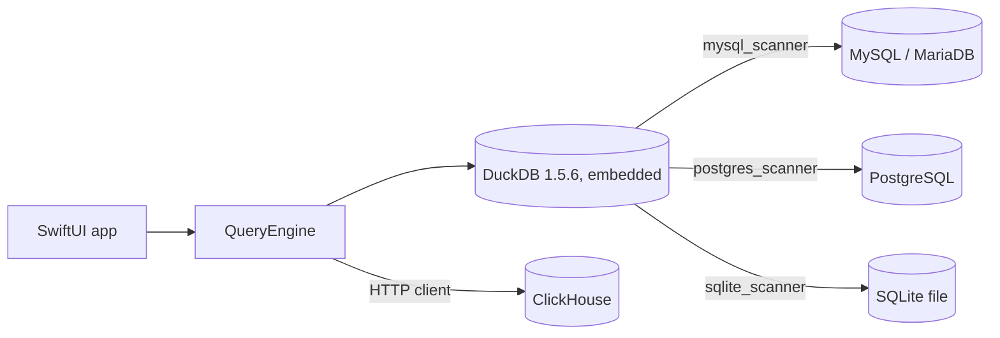
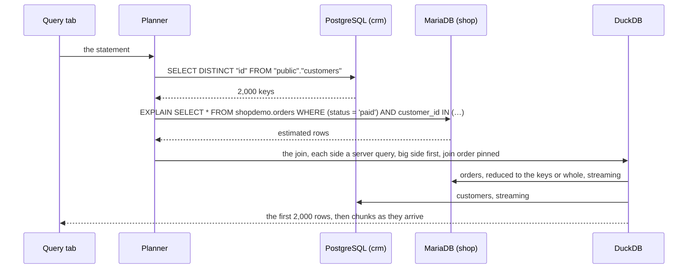

# Architecture

How one statement reaches four kinds of database and comes back as one streaming
result, and why the app is built the way it is. The rules a query follows are in
[QUERYING.md](QUERYING.md); what each part of the app does is in
[FEATURES.md](FEATURES.md). Every name below is a type or a file in the repository, so
you can read along.

## The shape of it



One in-memory DuckDB lives inside the app. Every MySQL, PostgreSQL or SQLite
connection is attached to it as a catalog named after the connection's alias, through
DuckDB's scanner extensions, so `shop.orders` and `crm.customers` are two tables of one
engine that can join them.

ClickHouse is the one engine that is not attached, which is why it hangs off
`QueryEngine` in the diagram rather than off DuckDB. When this was built, DuckDB's only
ClickHouse extension was a community build a few weeks old, so the app talks to
ClickHouse over its HTTP interface with a small client of its own instead. That single
difference explains every ClickHouse rule in this guide:

| | MySQL / MariaDB, PostgreSQL, SQLite | ClickHouse |
|---|---|---|
| How the app reaches it | attached to DuckDB through a scanner extension | its HTTP interface, through the app's own client |
| A statement that names only it | runs on that server (a SQLite file is read by DuckDB) | runs on ClickHouse, never touching DuckDB |
| A join with one other server | both sides stream through DuckDB, the bigger side reduced to the smaller side's keys | its side is copied into a DuckDB temp table first, then joined the same way |
| Joins it can take part in | any shape DuckDB runs, three tables or more included | two tables, one of them ClickHouse |
| Column types in a join | DuckDB's own mapping in the scanner | integers, floats, booleans, dates and timestamps typed; the rest as text |

That is the whole trick. Everything below is about making it fast and honest: fast,
because a naive join would drag whole tables across the network; honest, because the
app tells you exactly what it sent to each server.

## A map of the code

| Layer | Files | What they do |
|---|---|---|
| App state | `Models/WorkspaceSession.swift`, `QueryTab.swift`, `Utilities/AppSettings.swift` | The open connections, query tabs, the console log and history, saved queries, which panel is active. Settings live in UserDefaults: theme, editor font size, tab width, auto-complete. |
| Connections | `Engine/ConnectionManager.swift`, `Utilities/ConnectionStore.swift`, `Keychain.swift`, `Engine/SSHTunnel.swift`, `Utilities/SupportDirectory.swift` | The saved list (`connections.json`), passwords (one Keychain item per connection id under the service "SequelBridge"), connect and disconnect, SSH port forwards, where the app's files live. |
| Engine | `Engine/QueryEngine.swift` and its `+Postgres`, `+SQLite`, `+ClickHouse` extensions | One DuckDB, four connections to it, attach and detach, streaming results, the planner's entry points, per-engine metadata. |
| Planner | `Engine/SQLBuilder.swift` (+ `SQLBuilder+Postgres.swift`), `Engine/SQLPushdown.swift` | Statement classification (`isReadOnly`, `isRowReturning`, `referencesAlias`, `detectCrossJoin`, `detectSemiJoin`), the rewrites (`crossJoinRewrite`, `planFallback`), per-dialect quoting and DDL, and which WHERE conditions each server can be trusted with. |
| Native clients | `Engine/ClickHouseClient.swift`, `Engine/MySQLClient.swift`, `Engine/MySQLDirectConnection.swift` | ClickHouse over HTTP; a minimal MySQL wire-protocol client for the two statements the scanner cannot prepare (`EXPLAIN`, `SHOW CREATE TABLE`). |
| Results | `Models/QueryResult.swift`, `CellTable.swift`, `StreamBatcher.swift`, `RunClock.swift`, `ChartData.swift`, `Engine/ResultExporter.swift` | The result's columnar storage, when streamed chunks reach the screen, one clock per run, chart series, CSV/JSON/Markdown/SQL export. |
| Views | `Views/Home/*`, `Views/Workspace/*` | Home and the connection form; the workspace: toolbar tabs (`WorkspaceView`), sidebar, the Query tab (`QueryPanelView`, which also dispatches each statement), editor, results grid and chart, and one file per panel. |
| Stores | `Utilities/HistoryStore.swift`, `SavedQueryStore.swift`, `CSVParser.swift`, `ConsoleExporter.swift` | Statement history (`history.jsonl`, append-only, compacted at 1,000 entries), saved queries (`saved_queries.json`), an RFC 4180 CSV reader, the console's `.sql` export. |
| Scripts | `scripts/` | `fetch-duckdb.sh` (the static libraries), `run-all-tests.sh` (containers, fixtures, the whole matrix), `seed-demo.sh` and `capture-screenshots.sh` (the demo data and the guide's images), `check-docs.sh`. |
| Vendored DuckDB | `vendor/DuckDB/` | The Swift wrapper with three local patches; the libraries themselves are fetched, not committed. |

## A connection's life

1. On Home you tick connections and press Connect. `ConnectionManager.connect` first
   detaches any alias still attached from an earlier workspace, then resolves each
   password: a fixture's inline password if the app was launched on one, else the
   Keychain item for that connection id, else an empty string for a SQLite file.
2. `QueryEngine.attach` does the engine-specific work:
   - **MySQL / MariaDB, PostgreSQL.** The scanner extension is loaded once per launch
     (`ensureExtensionLoaded`): if it is not in `~/Library/Caches/SequelBridge/duckdb/1.5.6/`
     it is downloaded from `extensions.duckdb.org` for the machine's architecture,
     ad-hoc signed on Apple Silicon, then `LOAD`ed. A DSN is built for TCP/IP, a local
     socket, or SSH. A MySQL socket is the DSN's `socket=` file; a PostgreSQL socket
     becomes libpq's `host=<directory> port=<n>`, taken from the directory or from the
     `.s.PGSQL.<n>` file the user gave. For SSH, `startTunnel` opens an `SSHTunnel`
     (below) first and the DSN points at its local port. Then
     `ATTACH '<dsn>' AS "alias" (TYPE mysql)` or `(TYPE postgres)`. The DSN's database is
     remembered, because the passthrough needs one, and for MySQL so is the endpoint the
     built-in client uses for EXPLAIN: the tunnel's local port or the socket file.
   - **SQLite.** `ATTACH '<path>' AS "alias" (TYPE sqlite)`.
   - **ClickHouse.** A `ClickHouseClient` with host, port, user, password and TLS, tried
     with `SELECT 1`; through SSH, it talks to the tunnel's local port. Nothing is
     attached to DuckDB, and a socket is refused with a message, since the HTTP
     interface has none.

   **The tunnel.** `SSHTunnel` runs `/usr/bin/ssh -N -L <local>:<host>:<port>` with
   your key only (`IdentitiesOnly`), no prompts (`BatchMode`), new host keys accepted
   once and checked after (`StrictHostKeyChecking=accept-new`), and `ssh-rsa` appended
   to the accepted host-key and signature types: OpenSSH 8.8 and later switched it off,
   which locked out servers running OpenSSH 7.1 and older ("no matching host key type
   found. Their offer: ssh-rsa"). Appended, it is used only when the server offers
   nothing newer. A tunnel ends when its connection detaches, and every tunnel ends
   when the app quits: a child process outlives its parent on macOS, so `ssh` would
   otherwise keep the session open in the background.
3. Picking a database in the sidebar re-attaches a MySQL or PostgreSQL connection with
   that database as the DSN default (`adoptDatabase`). The passthrough functions
   `mysql_query` and `postgres_query` run on the connection's default schema, so this
   is what makes an unqualified table name in your statement resolve on the server.
4. Disconnecting detaches the catalog, drops the connection's metadata cache, and stops
   its tunnel.

A read-only connection is remembered by the engine at attach time; every write path
checks it (`ensureWritable`) before anything reaches a server.

## How a statement is dispatched

`QueryPanelView.runQuery` looks at the statement before it runs:

1. If it writes (`SQLBuilder.isReadOnly` says no) and any open connection is read-only,
   it is refused with the connection's name.
2. A typed `EXPLAIN …` that names one MySQL or PostgreSQL server takes the Explain
   button's path: the server's own plan, on the native MySQL client where the scanner
   cannot prepare it.
3. Otherwise the servers it names are counted (`referencesAlias` per alias) and the
   statement goes down one of these paths. Every path keeps a plain form of the
   statement as its backstop, so a plan that cannot proceed falls back rather than
   failing.

| The statement | Path | What the servers see |
|---|---|---|
| names one MySQL or PostgreSQL server | passthrough | the statement, as written, inside `mysql_query('alias', '…')` or `postgres_query(…)`; the server executes it, DuckDB streams the result |
| names one ClickHouse server | native | the statement on ClickHouse over HTTP, with `alias.table` turned into `database.table` |
| names only a SQLite file | DuckDB | DuckDB reads the file |
| `… WHERE x IN (SELECT … FROM other.table)` across two servers | semi-join | the subquery on its server first, its values inlined (up to 10,000), then the outer statement on its own server |
| two tables on one key, inner join, in `JOIN … ON` or comma form | streaming cross-server join | the steps traced below |
| the same with one ClickHouse side | ClickHouse bridge | the ClickHouse side copied first, then the steps below |
| anything else across servers | fallback | each remote table bound, then copied, then DuckDB runs the statement |

## One query, traced

The Console tab shows every statement the app sends. Here is the two-table join from
the guide, run against the demo servers, with what went where.

```sql
SELECT o.id, o.placed_at, o.status, c.full_name, c.email
FROM shop.orders o JOIN crm.customers c ON o.customer_id = c.id
WHERE o.status = 'paid'
ORDER BY o.placed_at DESC
```



| Step | Statement the app sent | Where | Result |
|---|---|---|---|
| 1 | `SELECT DISTINCT "id" FROM "public"."customers"` | PostgreSQL | 2,000 keys in 0.014 s |
| 2 | `EXPLAIN SELECT * FROM shopdemo.orders WHERE (status = 'paid') AND customer_id IN ('1', '2', …)` | MariaDB | the server's own row estimate |
| 3 | the join, with each side a server query inside one DuckDB statement | both, streaming | 2,506 rows in 0.324 s |

Step 1 picks the *probe* side: the table the servers estimate to be smaller
(customers, 2,000 rows, against orders, 5,000) gives up its distinct join keys, with
its own WHERE conditions applied on its server first. Step 2 asks the other server how
much of its table those keys would select. Below 40 % of the table, the orders query is
sent with `customer_id IN (…)` so only matching rows cross the wire; at 40 % or more, or
with more than 10,000 keys, the whole side comes instead, because a table scan on the
server beats pulling most of a table through an index. Step 3 runs both server queries
as streaming subqueries of one DuckDB statement and joins the rows as they arrive.
Nothing is written to a temp table; the first rows reach the grid while the bigger side
is still coming in.

The three-engine query on the README takes a different path, because it joins four
tables:

| Step | Statement | Why |
|---|---|---|
| 1 | `SELECT * FROM "public"."customers" LIMIT 0`, and the same for `orders` and `order_items` | bind the statement against the real column shapes before fetching anything, so a misspelled column fails in milliseconds |
| 2 | `SELECT * FROM "public"."customers"`, `SELECT * FROM shopdemo.orders`, `SELECT * FROM shopdemo.order_items`, each with the WHERE conditions the server can be trusted with | copy each remote table into a DuckDB temp table through its server's own query path |
| 3 | the statement itself on DuckDB, reading the temps and the SQLite file in place | 200 rows in 0.029 s |
| 4 | `DROP TABLE IF EXISTS "__sb_mat_0"` … | clean up |

That path is correct for any SQL DuckDB understands, and it is the fallback for every
plan that cannot proceed. Its cost is the copy, which is why the guide says to keep
cross-server statements to two tables on one key when the tables are large.

## The cross-server join in detail

**Recognizing one** (`SQLBuilder.detectCrossJoin`). Two base tables from two different
connections, an inner join on one key: `FROM a.t1 x JOIN b.t2 y ON x.k = y.k`, or the
comma form `FROM a.t1 x, b.t2 y WHERE x.k = y.k AND …` where the key equality is a
top-level `AND` conjunct of the WHERE. Outer joins, three tables, a key equality under
an `OR` or inside parentheses: not this path.

**Choosing sides** (`crossJoinBigSide`). The *big* side is the one that streams through
the join from its server; the *probe* side gives up its keys. A side without a server
query path (a SQLite file) is always the probe. Between two servers, the larger row
estimate is big; an unknown estimate counts as the largest; a tie makes the first
table the probe. Estimates come from the servers' own catalogs: the row count MySQL
keeps for the table (`SHOW TABLE STATUS`), `reltuples` in PostgreSQL with a fallback
to the statistics collector's live count for a table never analyzed.

**Reducing the big side** (`QueryEngine.keyReductionPlan`). The probe's distinct keys
are fetched through its server with its pushed WHERE. More than 10,000 keys cannot be
inlined, so the whole side comes. Otherwise the big side's server is asked, with
`EXPLAIN`, how many rows the statement with the `IN` list would touch; at 40 % of the
table or more the whole side comes. The threshold is measured, not guessed: on a real
server a key list covering 2.6 million of 2.6 million rows took 300 seconds to return
through the index, against 30 seconds for a plain whole-table fetch. No estimate means
reduce.

**Rewriting the statement** (`crossJoinRewrite`). Only the `FROM … JOIN … ON` clause
changes: each side becomes a parenthesized server query, `(SELECT … FROM
mysql_query('shop', '…'))`, the big side listed first, with a `SELECT *` spelled out
per side so the output columns keep your order. The aliases, the WHERE and the rest of
the statement still resolve as you wrote them.

**Pinning the join order.** DuckDB cannot see how big a server query's result is; it
estimates every table function at one row and, between equal estimates, builds its
hash table on the narrower side. On real data that put a 4.7-million-row side on the
build side, and the first row could not appear until all of it had arrived. The join
statement therefore runs after `SET disabled_optimizers =
'join_order,build_side_probe_side'` on its connection: DuckDB probes with the big side
and builds its hash table on the probe side, the big side flows through, and rows
appear within seconds. The connection resets the setting right before its next
statement, not when the stream opens, because any statement on a connection closes
its live stream.

## What the servers are trusted with

Predicate pushdown (`SQLPushdown.swift`) gives each table the WHERE conditions it can
answer on its server: its own, plus any carried to it across the join key (`x.k = y.k`
and `x.k = 'A'` imply `y.k = 'A'`). The principle that keeps results identical: DuckDB
still evaluates your whole WHERE on the rows that come back, so a pushed condition
only has to admit every row DuckDB would keep. It may be a superset filter, never a
stricter one. That rules the shapes:

| Column kind | Pushed | Kept for DuckDB, and why |
|---|---|---|
| strings | `=`, `IN`, `LIKE`, `IS [NOT] NULL` | `<>`, `<`, `>`, `NOT IN`, `NOT LIKE`, `BETWEEN`: under a case-insensitive server collation they would drop rows DuckDB keeps |
| numbers, dates, timestamps | every comparison, `BETWEEN`, `IN`, `NOT`, with a literal of the same kind (dates only as ISO text) | other literal shapes |
| ClickHouse `Enum8` / `Enum16` | `=`, `IN`, `IS [NOT] NULL` | `LIKE` |
| any | | functions, arithmetic, subqueries, a branch of an `OR`, a bare column that two tables share, a string literal with a backslash |

A pushed condition is written in the server's dialect (backticks or double quotes) and
runs there with an index if the server has one; what is not pushed still applies, in
DuckDB, on the rows that arrive.

## The other paths

**Passthrough.** A statement naming one MySQL or PostgreSQL server is sent as
`SELECT * FROM mysql_query('alias', '<your statement>')` (or `postgres_query`). The
server executes it as written; DuckDB only streams the result. This is why a
single-server statement is server-native SQL, LIMIT and all, with no scanner in the
way.

**Semi-join** (`detectSemiJoin`). `WHERE x IN (SELECT … FROM other.table)` across two
servers runs the subquery on its server first, inlines its values with `inValueList`
(up to 10,000 non-null values), and pushes the outer statement to its own server. Too
many values, or a subquery that turns out correlated, and the statement falls back.

**Fallback** (`planFallback`). Every `alias.table` reference to a MySQL or PostgreSQL
table is collected once per table and replaced by a temp identifier (`__sb_mat_N`).
Each table is first bound with `LIMIT 0` so a wrong column fails before any row moves,
then copied with `CREATE TEMP TABLE … AS SELECT * FROM mysql_query(…)` carrying its
pushed WHERE, through the same extension and type mapping the scanner uses, so the
rows are identical. The rewritten statement runs on the temps, with a SQLite file read
in place, and the temps are dropped afterwards.

**ClickHouse bridge** (`clickHouseJoinPlan`, `materializeClickHouse`). The ClickHouse
side is fetched over HTTP into a DuckDB temp table whose columns are typed through
`clickhouseToDuckType` so the join keys line up. When ClickHouse holds the bigger
table, the fetch is reduced to the other side's keys with `toString(key) IN (…)`; its
pushed WHERE runs in ClickHouse either way. The join then proceeds as a cross-server
join with the temp on one side.

## Results stream

A result is never materialized twice. Inside the engine, four DuckDB connections each
live in a `SerialConnection` actor: one for the Query tab, one for the Content browser,
one for fast schema metadata and one for slow statistics, so a long query never blocks
browsing a table and the sidebar never blocks a query. Every statement runs as a DuckDB
streaming result and chunks are pulled on the actor, off the main thread.

The metadata connection is shared by the Structure, Relations and Triggers tabs, so one
slow lookup there stalls all three. Each lookup reads one table: `SHOW FULL COLUMNS`,
`SHOW INDEX`, `SHOW TRIGGERS`, or an information_schema query that filters every
information_schema table it reads by schema and table name, with literals. MariaDB, and
MySQL before 8, answer anything else by opening every table on the server.

DuckDB allows one live streaming result per connection; running anything else on it
closes the stream. So each open stream has its own cursor, and before another
statement starts on that connection the actor fetches every open stream's remaining
chunks into its cursor's buffer: an earlier query in another tab still completes with
its full result. A statement DuckDB cannot prepare (several statements in one string)
falls back to a materialized result read by row ranges.

`openStreamingQuery` returns the first 2,000 rows immediately for the first paint and a
handle for the rest. Each pulled chunk is converted in one pass into a `CellTable`
chunk: per column, one UTF-8 buffer with every value back to back, one end offset per
row, and a null flag per row only where the column has NULLs. That is the text itself
plus about four bytes a cell, where the `[[String]]` it replaced cost about 120 bytes a
cell and put a 4.7-million-row result at 6 GB. Chunks are immutable and appended as
the stream arrives, so growing a result never copies what is already there; a cell is
found by a binary search over the chunk starts, and values are decoded to `String`
only for the cells on screen.

`StreamBatcher` decides when chunks reach SwiftUI: the stream pulls 20,000-row chunks,
and publishing each one would re-render the workspace and copy the tab's growing
result (the tab is a value in a published array), which made a million rows cost fifty
full copies. Chunks are buffered and flushed when enough rows have accumulated or
enough time has passed, so the row counter keeps moving while publishes stay bounded
to a handful per million rows. The table view draws frame-based cells, so growth is an
append rather than a reload. One `RunClock` per run feeds both the toolbar counter and
the status bar's query time, so they cannot drift apart.

Measured on the same queries before and after that work (Release build):

| Query | Before | After |
|---|---|---|
| 4.7M rows × 14 columns, cross-server join over a VPN: first rows | 59 s | 11.6 s |
| the same: finished | 168 s | 68 s |
| the same: peak memory | 10.8 GB | 2.5 GB |
| 5M local rows × 10 columns: first screen | ~30 s | 1.9 s |
| the same: peak memory | 3.1 GB | 905 MB |

**Cancel.** The Cancel button interrupts the Query tab's DuckDB connection
(`interruptUserQuery`), which aborts the statement inside DuckDB and frees the
connection for the next one, and cancels the ClickHouse client's in-flight request. A
statement a server is already running is not killed; it finishes there on its own.

## ClickHouse beside DuckDB

`ClickHouseClient` posts a statement to the server's HTTP interface with the user in a
header and reads the rows back as text, with the column types ClickHouse reports. A
single-server ClickHouse statement never touches DuckDB, and the Server panel reads
`system.query_log` through the same client.

When a join needs a ClickHouse table, its rows go into a DuckDB temp table whose
columns are typed by `SQLBuilder.clickhouseToDuckType`, conservatively:

| ClickHouse type | In the DuckDB temp table |
|---|---|
| Int8 to Int64, UInt8 to UInt32 | `BIGINT` |
| Float32, Float64 | `DOUBLE` |
| Bool | `BOOLEAN` |
| Date, Date32 | `DATE` |
| DateTime, DateTime64 | `TIMESTAMP` |
| everything else: UInt64 and wider integers, Decimal, UUID, IPv4, IPv6, Enum, String, Array, Map, JSON | `VARCHAR`, exactly as ClickHouse sent it |

`Nullable(…)` and `LowCardinality(…)` are unwrapped first. A join key from the last row
still matches: DuckDB converts the text to the other side's type when the join compares
them, so a UInt64, Decimal or UUID key from ClickHouse meets an unsigned, decimal or UUID
column on the other side as it should. Values of those types show in the results as
ClickHouse sent them. Joining ClickHouse with ClickHouse, or with three or more tables,
is not supported.

## The native MySQL client

DuckDB's `mysql_query` prepares every statement to learn its result types, and MariaDB
cannot describe `EXPLAIN` or `SHOW CREATE TABLE` that way. `MySQLClient` is a minimal
client over the wire protocol for exactly those two: protocol 41, `COM_QUERY` with the
text result protocol, one short-lived connection per call. It logs in with the method
the server asks for: `mysql_native_password` (MariaDB, MySQL 5.7) or
`caching_sha2_password` (MySQL 8 and later). A first `caching_sha2_password` login needs
the password itself, so over TCP the client fetches the server's RSA key and sends the
password encrypted with it; over a Unix socket it sends it in clear, as MySQL allows.
With Use SSL it does what MySQL asks: after the plain-text greeting it sends the
SSLRequest, switches the same connection to TLS (a `URLSessionStreamTask`, whose
`startSecureConnection()` can; Network.framework can't), and logs in inside it, where a
first `caching_sha2_password` login sends the password itself. Like the scanner's
`ssl_mode=required`, it encrypts without checking the server's certificate, and a
server that doesn't offer SSL is refused, never asked in clear. A refused or
unreachable server fails at once, and no connect waits longer than ten seconds. Everything else goes through the scanner.

## Metadata

Every panel reads schema through the engine, with one implementation per engine:

| Engine | Source |
|---|---|
| MySQL / MariaDB | `information_schema` and `SHOW` statements; `SHOW CREATE TABLE` on the native client |
| PostgreSQL | `pg_catalog`, every statement verified against 16.15; the row estimate falls back to the statistics collector's live count for a table never analyzed |
| SQLite | the pragmas; constraints are parsed out of the stored `CREATE` text (`SQLiteSchema`), since SQLite keeps no catalog of them |
| ClickHouse | the `system` tables |

Table metadata is cached per connection and dropped on detach. Writes made from the
panels (column edits, Create Table, CSV import, dumps) are built per dialect by
`SQLBuilder` and pass the same read-only guard as typed statements. A cell edit is an
`UPDATE` keyed by the row's primary key, through the same guard (`executeWrite`). A
Query-tab result is edited only when it is one table's rows with that key in it:
results reach the app through DuckDB without the column origins MySQL's protocol
carries, so `ResultEditing` reads the origin from the statement and matches each result
column to the table's columns before anything is written.

## What is on disk

| What | Where |
|---|---|
| Saved connections | `~/Library/Application Support/SequelBridge/connections.json`, no passwords |
| Passwords | the Keychain, service "SequelBridge", one item per connection id |
| Statement history | `history.jsonl` beside the connections, append-only, compacted to the newest 1,000 |
| Saved queries | `saved_queries.json` beside the connections |
| Settings | UserDefaults: theme, editor font size, tab width, auto-complete, whether the conventions note is expanded |
| Scanner extensions | `~/Library/Caches/SequelBridge/duckdb/<version>/` |

Launch arguments change this for a demo or screenshot instance: `-SBConnectionsFile
<path>` reads a fixture connection list with inline passwords and never writes it
back; `-SBSupportDir <dir>` moves the three files above into that folder.

## The DuckDB the app ships

DuckDB 1.5.6 is linked statically from prebuilt universal libraries fetched by
`scripts/fetch-duckdb.sh`, behind the thin Swift wrapper vendored in `vendor/DuckDB`.
Three local patches, each marked in the source and listed in that folder's README:

- a streaming result type over `duckdb_fetch_chunk`, so a large result is never
  materialized inside DuckDB;
- bulk column readers that walk each data chunk once, where the stock per-cell access
  allocated three objects per cell;
- a chunk index for the result set, where the stock lookup walked every chunk from the
  first on each access (quadratic in rows).

The scanner extensions are loadable modules downloaded once per DuckDB version from
`extensions.duckdb.org`, ad-hoc signed on Apple Silicon so the system will load them,
and loaded with `allow_unsigned_extensions`.

## Security model

- Passwords are Keychain items keyed by the connection's id; the connection list is a
  JSON file without them.
- Both drivers put the whole connection string, password included, in a connection
  error. `QueryEngine.connectionError` removes it and hides any password before a
  message is shown or logged.
- Use SSL is `ssl_mode=required` (MySQL) or `sslmode=require` (PostgreSQL): encrypted or
  refused, the certificate not verified. Without it each driver encrypts when the server
  offers TLS.
- An SSH connection (MySQL, PostgreSQL, ClickHouse) opens a local port forward with
  your key file (`SSHTunnel`); a key path that does not exist fails loudly rather than
  letting `ssh` fall back to an agent or a default key. The forward closes on
  disconnect and on quit.
- Plain HTTP is allowed to any server (`NSAllowsArbitraryLoads`), because a ClickHouse
  HTTP interface is often reached by host name without TLS; HTTPS is verified as always.
- Read-only is a property of the engine's attachment, not of the interface: every
  write path, typed or clicked, passes `ensureWritable`, and while a read-only
  connection is open a typed statement that writes is refused whichever server it names.
- A demo or screenshot instance never shows or touches the owner's connections,
  Keychain items or history.
- The app sends nothing anywhere but to your servers.

## Known limits

- Cancel stops the app's work. A statement a server is already running finishes there
  on its own; the app does not kill it.
- A cross-server statement with three or more tables, an outer join, a UNION or a
  subquery in FROM copies each remote table whole (after its pushed conditions).
- ClickHouse joins are two-table only; ClickHouse with ClickHouse is not supported.
- The Explain button serves MySQL and PostgreSQL. Structure edits on ClickHouse are
  typed, not clicked.
- An SSH server that offers only DSA (`ssh-dss`) host keys cannot be reached: current
  macOS `ssh` no longer supports DSA at all.
- Use SSL can't name a CA or client certificate, and doesn't verify the server's.

## Testing

Two layers. Hermetic unit tests run on every build with no database: SQL builders,
the planner's detection and rewrites, pushdown rules, result storage, exporters,
formatter, stores. Gated suites run against local MariaDB, PostgreSQL and ClickHouse
containers that `scripts/run-all-tests.sh` provisions and seeds from committed SQL.
The rule that makes planner work safe to ship: every optimized plan has a test that
compares its rows, row for row, with the plain plan's. A reduction may make a query
faster; it may never change the answer. The streaming tests assert that first rows
arrive well before a transfer ends. [TESTING.md](../TESTING.md) lists every suite.

## Distribution

SequelBridge ships as a signed, notarized DMG, not through the App Store. The scanner
extensions are loadable modules DuckDB downloads at first use, and the App Store
forbids downloaded executable code. Shipping them inside the app instead is not
possible either: the MySQL scanner cannot be linked statically, and a loadable
extension carries DuckDB's metadata after its Mach-O, which the strict signature
validation of an app bundle rejects.
