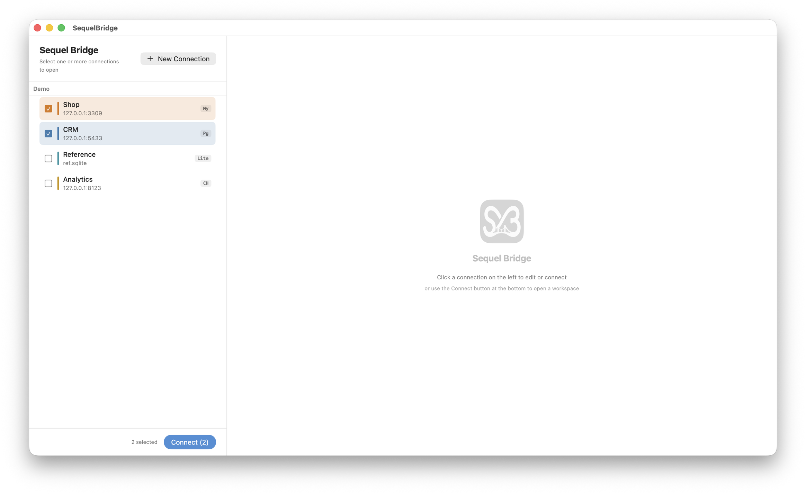
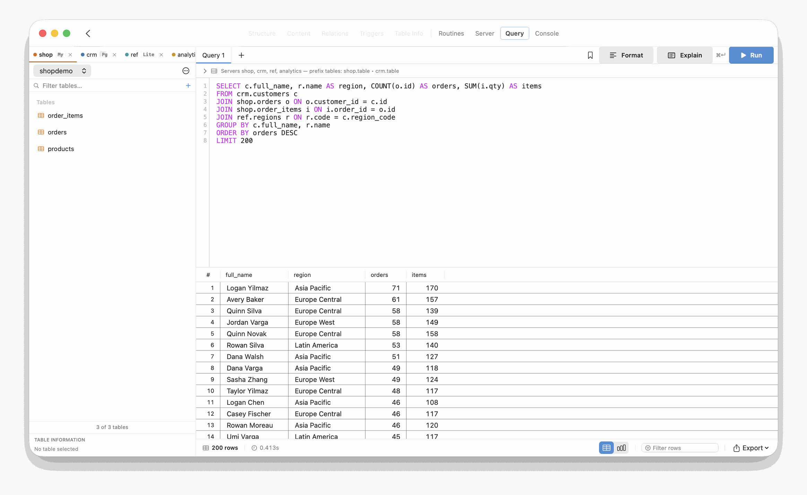
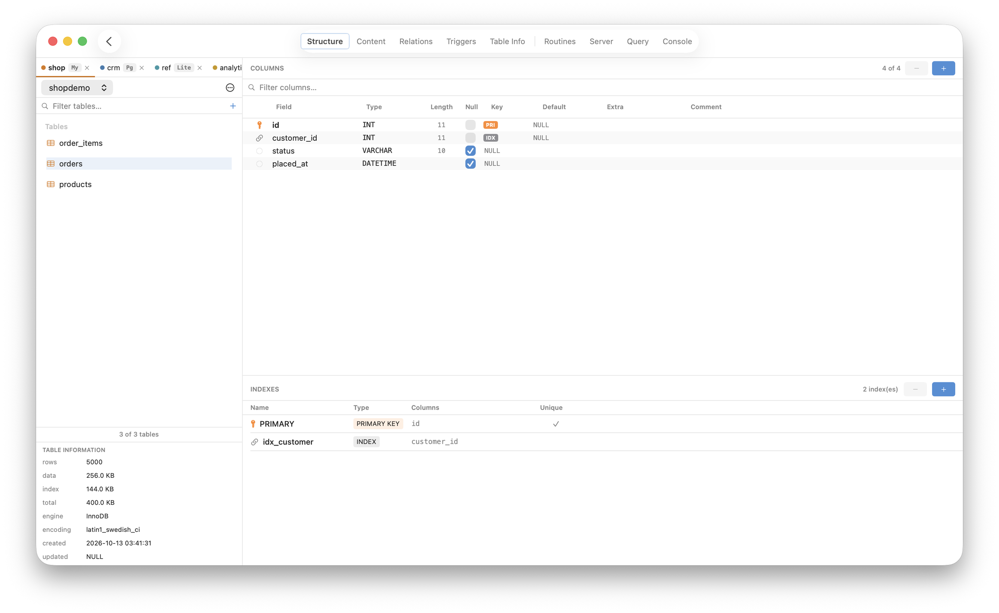
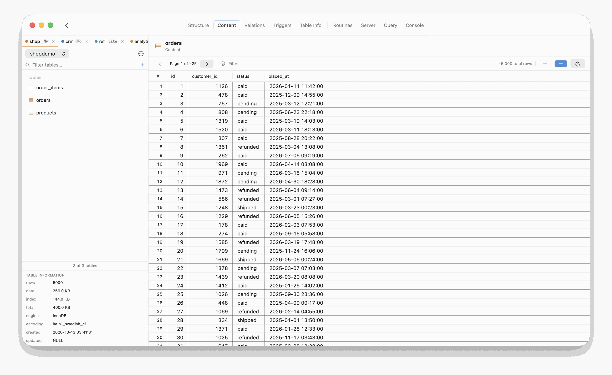
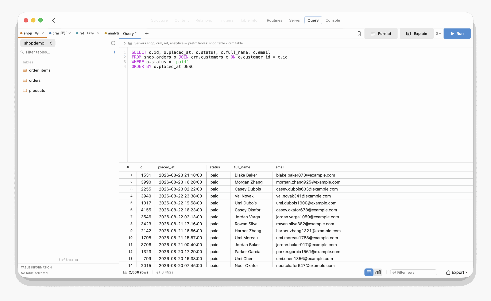
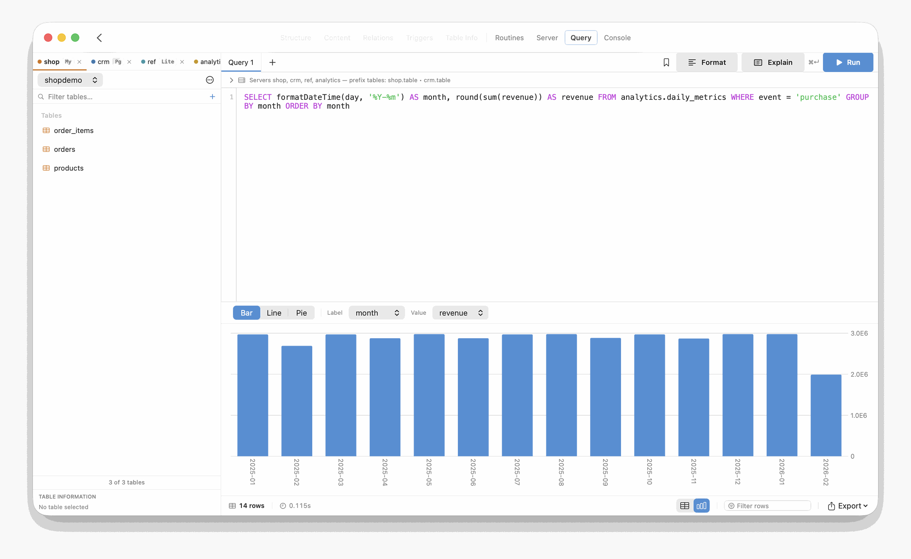
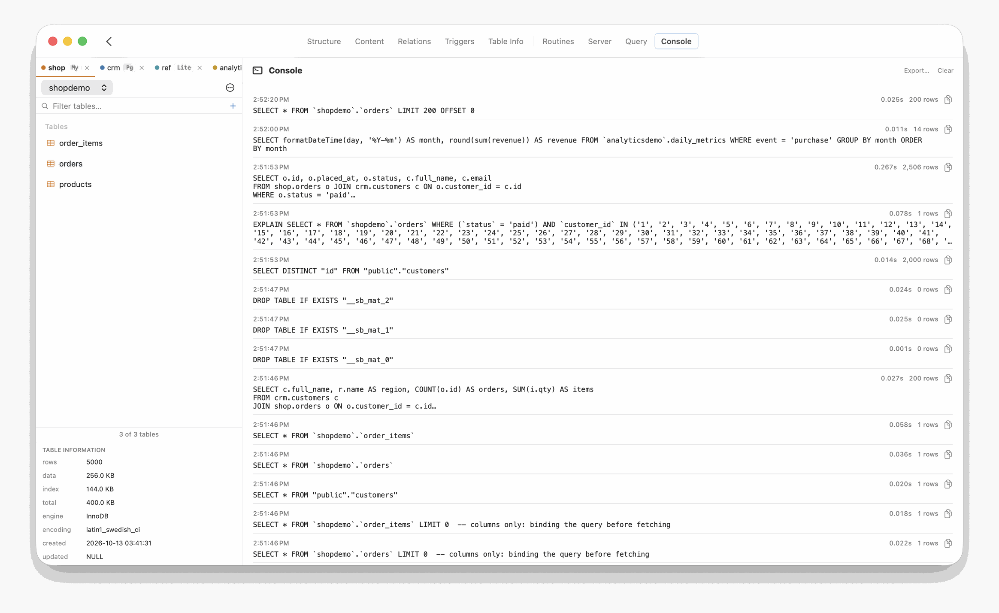

# Features

What SequelBridge does, organized by what you are trying to do. Every claim here
describes the app as it is; the table below says what works on which engine. The
rules a query follows are in [QUERYING.md](QUERYING.md), and how it all works inside
is in [ARCHITECTURE.md](ARCHITECTURE.md).

Screenshots come from a demo instance on synthetic data.

## What works where

| | MySQL / MariaDB | PostgreSQL | SQLite file | ClickHouse |
|---|:-:|:-:|:-:|:-:|
| Connect over TCP/IP | ✓ | ✓ | file | ✓ (HTTP) |
| Connect over a socket | ✓ | ✓ | | |
| Connect through an SSH tunnel | ✓ | ✓ | | ✓ |
| Read-only mode | ✓ | ✓ | ✓ | ✓ |
| Browse tables, Structure, Table Info | ✓ | ✓ | ✓ | ✓ |
| Content: browse, filter, sort | ✓ | ✓ | ✓ | ✓ |
| Content: edit, insert, delete rows | ✓ | ✓ | ✓ | |
| Query results: edit values | ✓ | ✓ | ✓ | |
| Add columns and indexes, Create Table | ✓ | ✓ | ✓ | type the `ALTER`/`CREATE` in the Query tab |
| Relations (foreign keys) | ✓ | ✓ | ✓ | |
| Triggers | ✓ | ✓ | ✓ | |
| Routines | ✓ | ✓ | | |
| Server: processes with Kill, variables, status | ✓ | ✓ | | |
| Server: query insights from the query log | | | | ✓ |
| Explain button, typed `EXPLAIN` on the server | ✓ | ✓ | | typed only |
| Export database as SQL | ✓ | ✓ | ✓ | |
| Export one table as SQL | ✓ | | | |
| Import CSV into an existing table | ✓ | ✓ | | |
| Import CSV into a new table | ✓ | | | |
| One side of a cross-server join | ✓ | ✓ | ✓ (probe side) | ✓ (copied) |
| Results: streaming grid, filter, charts, export | ✓ | ✓ | ✓ | ✓ |

Row editing needs a primary key on the table; a query result is edited when it is one
table's rows with that key in it. A typed `EXPLAIN` on a SQLite file shows DuckDB's plan.

## Connecting



Home lists your saved connections. Tick one or more and press **Connect**: they open
together in one workspace, which is what lets a query name tables from several of
them. Each connection has a name, an alias (the prefix you use in queries), a colour
that follows it through the workspace, and an optional folder that groups the list.

A connection is TCP/IP, a local socket or an SSH tunnel; a SQLite connection is just
the file. The form offers only what the engine supports: ClickHouse, reached over
HTTP, has no socket. For a socket, MySQL takes the socket file and PostgreSQL its
directory, or the `.s.PGSQL.<port>` file itself. An SSH tunnel logs in with your key
file, also on old servers that only offer the `ssh-rsa` key type, and closes when you
disconnect or quit the app. **Test Connection** on the form tries the connection,
tunnel included, before saving. Passwords go into your Keychain, never into the
connection file. A failed connection says why, in the server's words: a wrong
password, an unknown host, SSL required but not offered.

**Use SSL** makes a MySQL or PostgreSQL connection require an encrypted session, and
fail if the server doesn't offer one; the server's certificate isn't checked. Without
it the connection is still encrypted when the server offers TLS, as MySQL 8 does by
default. On ClickHouse it switches to HTTPS. On a MySQL connection with Use SSL, the
Explain button isn't available yet, and a table dump rebuilds its `CREATE TABLE`
without the foreign keys (it says so): both run on the app's own MySQL client, which
can't use SSL yet.

**Read-only (safe mode)** is a switch on the form. It shows as a badge on Home, and
from then on the engine refuses every write against that connection: typed statements,
cell edits, column DDL, imports, Kill. While a read-only connection is open in a
workspace, a typed statement that writes is refused whichever server it names. Use it
for production servers.

## Finding your way around



The sidebar has one tab per connected server, a database picker, a filter box for the
table list with a **+** beside it that creates a table, and a strip at the bottom with
the selected table's rows, data and index size, engine, encoding and timestamps. The
"…" button beside the picker holds the database-level actions (export as SQL; on MySQL,
import a CSV into a new table); a table's context menu has the table-level ones
(`SELECT *`, copy name, export as SQL on MySQL, import a CSV on MySQL and PostgreSQL).
Picking a database lists its tables; one that can't be opened says why, with
**Try Again**, and the connection stays on the database it had.

The toolbar tabs switch the main area: **Structure, Content, Relations, Triggers,
Table Info** for the selected table; **Routines, Server, Query, Console** for the
connection. Clicking a table in the sidebar inserts its name at the cursor in the
editor; double-clicking opens `SELECT * … LIMIT 200` in a new query tab.

## Looking at a table



**Structure** lists the columns with type, length, nullability, key and default, and
the table's indexes. Add a column or an index from here; the DDL is written in the
server's dialect and shown in the Console.



**Content** is a paginated browser of the rows. Type a filter to narrow it; click a
column header to sort, which reruns the page on the server with an `ORDER BY`.

Double-click a cell to edit it in place, as in Sequel Ace. Type the new value, then
press Return or click elsewhere to save it to the server; Esc leaves it as it was. If
the server refuses the value, the old one comes back and the server's message is shown,
with **Edit Again** to fix the value or **Discard**. **Set to NULL** is on the cell's
right-click menu. A cell that can't be edited says why instead: the connection is
read-only, the table has no primary key, or it is ClickHouse, where a row write is an
asynchronous table mutation. Rows can also be inserted and deleted, on the same terms.

**Relations** shows the table's foreign keys: the referencing column, the table and
column it points to, the ON DELETE and ON UPDATE rules, the constraint name.
**Triggers** shows timing, event and body. **Table Info** shows the storage engine, row
estimate, sizes, collation, comment, timestamps and the `CREATE TABLE` statement.
**Routines** lists the database's stored procedures and functions with their
definitions.

## Running a query on one server

The editor highlights SQL and completes table and column names as you type (switch
it off in Settings). **Run** (⌘↵) streams the result into the grid; select part of
the text to run only that. **Cancel** stops the app's work on the query; a statement a
server is already running finishes there on its own. **Format** tidies the statement.
**Explain** shows the server's own plan for a statement that names one MySQL or
PostgreSQL server, and typing `EXPLAIN …` does the same there; on ClickHouse a typed
`EXPLAIN` runs as a normal statement, and on a SQLite file it shows DuckDB's plan.

The bookmark button saves the statement under a name for later. Every statement you
run is kept in the history, which survives restarts; the Console tab shows it.

A statement that names one server runs on that server in that server's own SQL, as if
you had typed it into the server's own client. A statement that names no server runs
on the one picked at the top of the left panel, in the database picked there. A SQLite
file is read by DuckDB, so DuckDB SQL applies there.

As in Sequel Ace, `USE other_db` picks that database at the top of the left panel and
the statements after it run there; CREATE, ALTER, DROP and RENAME refresh the table
list, and creating or dropping a database refreshes the database list.

## Querying across servers



Prefix each table with its connection's alias and join as usual:

```sql
SELECT o.id, o.placed_at, o.status, c.full_name, c.email
FROM shop.orders o JOIN crm.customers c ON o.customer_id = c.id
WHERE o.status = 'paid'
ORDER BY o.placed_at DESC
```

The database is filled in from the sidebar's pick for that alias, else the
connection's own; write `alias.database.table` to be explicit. The collapsible note
above the editor restates these conventions for the servers you have open.

What happens for this statement: the smaller table's distinct join keys are fetched
from its server, the other server is asked (with its own EXPLAIN) how many rows those
keys select, and the bigger side comes over reduced to them or whole, whichever is
cheaper. Both sides stream into the app and are joined as they arrive, so the first
rows appear while the rest is still crossing the wire. Simple WHERE conditions run on
the servers. The Console shows each statement, so you can see exactly what each server
was asked.

Three or more tables, outer joins, UNIONs and subqueries also work across servers;
they run on the embedded DuckDB, with each remote table copied in first. A ClickHouse
table joins one other server's table the same way, with the ClickHouse side copied.
The full rules, with what is pushed to the servers and what is not, are in
[QUERYING.md](QUERYING.md); one query is traced statement by statement in
[ARCHITECTURE.md](ARCHITECTURE.md#one-query-traced).

## Working with results



Results stream in with no row cap; the status bar counts rows and shows the query
time. Double-click a cell to open it in a popup beside the cell: the full value, with a
JSON view for JSON text, and **Copy**, **Cancel**, **Edit** and **Save**. Edit and Save
change the value on the server when the result is one table's rows and includes that
table's primary key, which is Sequel Ace's rule: `SELECT id, status FROM shop.orders`
can be edited, while a join, a `GROUP BY` or a computed column can't, and the popup
says why. If the server refuses a value, the popup stays open with its message.
**Filter rows** narrows what is shown without rerunning the query. The right-click
menu copies a cell, a row, a row with its column names, the selected rows, or rows as
SQL `INSERT` statements. **Export** writes the result as CSV, JSON, Markdown or SQL
`INSERT` statements. The toggle at the right of the status bar turns the result into a
bar, line or pie chart: pick the label and value columns.

## Import and export

**Export database as SQL…** in the sidebar menu writes a dump of every table, schema
and data, for MySQL, PostgreSQL and SQLite; on MySQL a table's context menu exports it
alone. **Import CSV…** on a table's context menu loads a CSV into it (MySQL and
PostgreSQL); on MySQL the sidebar menu also creates a new table from a CSV, with
columns taken from the header.

## Server and Console

**Server** shows, for MySQL and PostgreSQL, the live process list with a **Kill**
button per entry, the server's variables and its status counters, each with a filter.
For ClickHouse, which has no process list in that sense, it reads `system.query_log`:
recent queries, the slowest by duration, and a roll-up by query type.



**Console** lists every statement the app sent on your behalf, with its duration, row
count and any error: your queries, the server-side steps of a cross-server join, the
metadata lookups behind the panels, the DDL behind a click. **Export…** writes the log
as a `.sql` file; **Clear** empties it.

## Settings and shortcuts

**Appearance** sets a light, dark or system theme. **Editor** sets the font size, tab
width and whether the editor auto-completes. **Connections** lists the saved
connections with Edit and Delete. **Shortcuts** lists these:

| Keys | Action |
|---|---|
| ⌘↵ | Run the query, or the selected text |
| Esc | Cancel the running query |
| ⌘T | New query tab |
| ⌘W | Close the current tab |
| ⌃⌥F | Format the statement |
| ⌘, | Settings |
